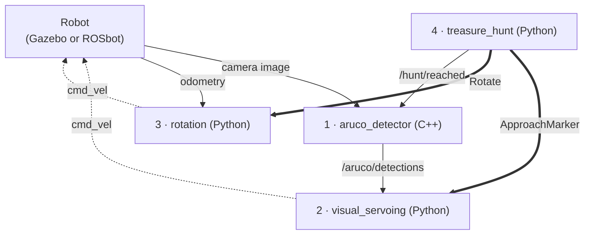
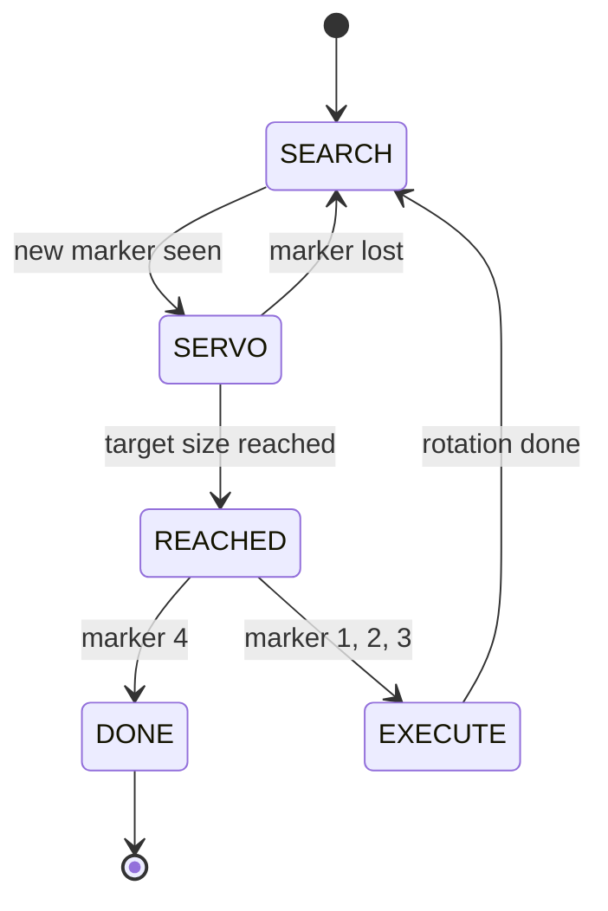

# ArUco Treasure Hunt — ROS 2

A mobile robot solves a treasure hunt using its camera and odometry. It looks for 4 ArUco markers, reaches each one with **image-based visual servoing (IBVS)**, executes the instruction written in the marker, and stops when it finds marker 4.

The project runs in **Gazebo** and on a real **ROSbot**. Only a parameter file changes between the two.

Experimental Robotics Laboratory — University of Genova.

## Demo

| Simulation | Real robot |
|---|---|
| _video link_ | _video link_ |

## The Hunt

| Marker | Instruction |
|---|---|
| 1 | Turn right 90°, then go ahead |
| 2 | Rotate 180°, then go ahead |
| 3 | Turn left 90°, then go ahead |
| 4 | Treasure found: stop |

- Dictionary: `DICT_ARUCO_ORIGINAL`, marker size 0.2 m
- The robot stops in front of each marker when the marker looks **166 px** wide (≈ 0.46 m from the camera)
- Each marker is used only once

## Architecture



| Node | Role |
|---|---|
| `aruco_detector` | Detects the markers and publishes their id, center and size in pixels. When a marker is reached, publishes the image with a circle and the id on `/marker_image`. |
| `visual_servoing` | Action server. Searches for a new marker, aligns with it and approaches it until it reaches the target size. |
| `rotation` | Action server. Rotates the robot by a given angle, closed-loop on the odometry yaw. |
| `treasure_hunt` | State machine. Calls the two actions in order and remembers which markers were already used. |

### State machine



## Control

**Visual servoing** (on the image, no 3D reconstruction):

- Align: `ω = −kω · (u − cx)`
- Approach: `v = kv · (sd − s)`

where `u` is the marker center, `cx` the image center, `s` the marker size and `sd` the target size. On the real robot, `sd` is scaled with the camera focal length (`sd = 166 · f_robot / f_sim`) so the robot stops at the same distance.

**Rotation**: the robot turns until the error between the target yaw and the odometry yaw is below a threshold. All angles are normalized to [−π, π].

## Repository Structure

```
src/
├── erl1/                 # Simulation: robot, world, ArUco boxes (from the course)
├── erl1_interfaces/      # Custom messages and actions
├── erl1_perception/      # ArUco detector (C++)
└── erl1_treasure_hunt/   # Visual servoing, rotation, state machine (Python)
    ├── launch/           # hunt_sim.launch.py, hunt_rosbot.launch.py
    └── config/           # sim.yaml, rosbot.yaml
```

## Requirements

- Ubuntu 24.04
- ROS 2 Jazzy + Gazebo

```bash
sudo apt install ros-jazzy-ros-gz ros-jazzy-robot-localization ros-jazzy-xacro \
  ros-jazzy-cv-bridge ros-jazzy-image-transport ros-jazzy-image-transport-plugins \
  ros-jazzy-rqt-image-view libopencv-contrib-dev python3-colcon-common-extensions
```

## Build

```bash
mkdir -p ~/erl_ws && cd ~/erl_ws
git clone https://github.com/Riadhe/<repo-name>.git .
colcon build
source install/setup.bash
```

## Run in Simulation

```bash
export GZ_SIM_RESOURCE_PATH=$GZ_SIM_RESOURCE_PATH:$HOME/erl_ws/src/erl1/models
ros2 launch erl1_treasure_hunt hunt_sim.launch.py
```

The hunt starts about 10 s after Gazebo opens. To follow it:

```bash
ros2 topic echo /hunt/status
ros2 run rqt_image_view rqt_image_view   # select /marker_image
```

## Run on the Real Robot

1. Connect to the robot's network and set its domain id (in every terminal):

```bash
export ROS_DOMAIN_ID=<robot_domain_id>
source install/setup.bash
```

2. Check the robot's namespace with `ros2 topic list` (e.g. `/rosbot_3/...`) and set it in `config/rosbot.yaml`:

```bash
sed -i 's#/rosbot_[0-9]*/#/rosbot_3/#g' src/erl1_treasure_hunt/config/rosbot.yaml
colcon build --packages-select erl1_treasure_hunt
```

3. Place the robot in front of marker 1 and launch:

```bash
ros2 launch erl1_treasure_hunt hunt_rosbot.launch.py
```

Emergency stop:

```bash
ros2 topic pub --once /rosbot_3/cmd_vel geometry_msgs/msg/Twist "{}"
```

## Parameters

Topics, gains, speeds and the hunt rules are all in `config/sim.yaml` and `config/rosbot.yaml`. After editing, rebuild `erl1_treasure_hunt`.

For example, to make marker 2 turn left instead of 180°:

```yaml
instruction_angles: [-1.5708, 1.5708, 1.5708]
```

## Results

| | Simulation | Real robot |
|---|---|---|
| Target size | 166 px | 125 px (scaled) |
| Size at each stop | ~162 px | ~122 px |
| Rotation error | < 1.1° | < 1.3° |
| Full hunt | ~80 s | ~100 s |

## Author

**Riadh Bahri** — MSc Robotics Engineering, University of Genova
